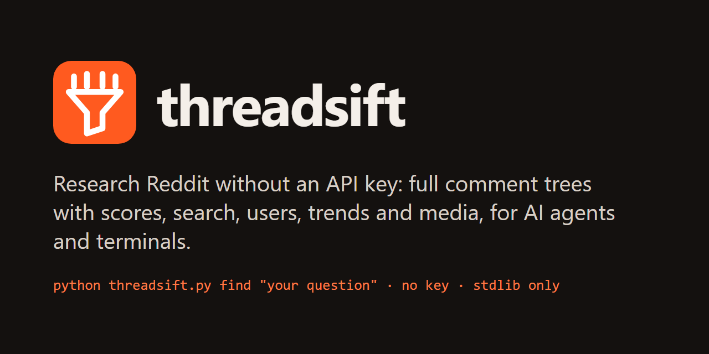

<p align="center"></p>
<h1 align="center"> threadsift</h1>
<p align="center"><b>Research Reddit without an API key.</b> Full comment trees with scores, search, users, subreddit growth, where a link was discussed, and the images and videos attached. Built for AI agents, usable from any terminal.</p>

## Benchmark: 9 research tasks, no credentials

The same tasks, run on one machine on 2026-10-18, against the keyless Reddit tools I could find that actually run.
Competitor tasks that failed were retried once after a 90-second pause (threadsift had no failures). All the tools share one IP's Reddit allowance, so they
ran one at a time.

| Task | **threadsift** | Hermes `reddit-reading` | arctic-shift-mcp | reddit-mcp-buddy | reddit-no-auth-mcp-server |
|---|---|---|---|---|---|
| Search all of Reddit | ✅ 10 results, all with scores | ✅ 10, no scores | ❌ needs a subreddit | ❌ forbidden | ❌ |
| Search one subreddit | ✅ 10, all with scores | ✅ 10, no scores | ❌ archive timeout ×2 | ❌ | ❌ |
| Read a thread | ✅ 43 comments, nested, scores | ✅ 37, flat, no scores | ✅ 43, scores | ❌ | ❌ |
| Top posts of the week | ✅ matches Reddit's ranking, scores | ✅ matches, no scores | ❌ returned newest, not top | ✅ matches, no scores | ❌ |
| User activity | ✅ 20 items + karma + all-time subs | ✅ 10, no scores | ✅ 10 posts | ❌ | ❌ |
| Get a gallery's 4 images | ✅ 4 downloaded | ❌ | ❌ | ❌ | ❌ |
| Where a GitHub repo was posted | ✅ 9 posts | ✅ 8 posts | — | ❌ | ❌ |
| Subreddit growth by month | ✅ 8 months | — | — | — | — |
| Open a link to one comment | ✅ that sub-thread only | ❌ whole thread | ❌ whole thread | ❌ | ❌ |
| **Passed** | **9/9** | **6/9** | **2/9** | **1/9** | **0/9** |

How to read this:
- I picked the tasks, and the last four test features threadsift was built to have. Read those rows as "can it do this
  at all". The first five are plain research tasks every tool claims to handle.
- This is one run, on one machine, without credentials. Hermes and reddit-mcp-buddy say in their READMEs that they get
  scores and deeper threads with an approved Reddit app. I didn't test that.
- Versions: Hermes reddit-reading @ d76cce4, arctic-shift-mcp 1.0.2, reddit-mcp-buddy 1.1.14, reddit-no-auth-mcp-server
  from PyPI on the same day.
- reddit-no-auth-mcp-server crashed on install as its README describes, then failed every call. Hermes's script crashed on
  Windows printing emoji until UTF-8 output was forced; that isn't counted against it. Error output:
  [`bench/competitor-errors-2026-10-18.log`](bench/competitor-errors-2026-10-18.log).
- Pass rules: [`bench/summarize.py`](bench/summarize.py). Scores as computed: [`bench/scores-2026-10-18.md`](bench/scores-2026-10-18.md).
  Raw outputs aren't published because they contain other people's Reddit posts; `bench/run.sh` regenerates them.
  `bench/run.sh` is that harness adapted to run from this repo (it downloads Hermes's script at the pinned commit);
  it has not been re-run in this exact form yet. It takes a while, mostly waiting on Reddit's rate limit.

## Quickstart

Python 3.10+ standard library, nothing to install.

```bash
git clone https://github.com/hamgarian/threadsift
cd threadsift
python threadsift.py doctor                                  # are Reddit RSS and Arctic Shift reachable?
python threadsift.py find "secrets manager docker" --sub selfhosted
python threadsift.py thread 1ogtyds --max-comments 60
```

Commands that ask Reddit itself (`find`, `top`, `doctor`) can pause for up to a minute; that's Reddit's rate limit
(see below). Everything else answers in seconds.

**As an agent skill** (Claude Code, or any agent that loads `SKILL.md` folders), clone it into your skills folder:

```bash
git clone https://github.com/hamgarian/threadsift ~/.claude/skills/threadsift
```

Then ask things like *"what does Reddit think of Bitwarden Secrets Manager?"*. The skill tells the agent which
commands to use, how to stay inside the rate limit, and when to look at media instead of guessing from a title.

Optional: [ffmpeg](https://ffmpeg.org) for video frames, and [uv](https://docs.astral.sh/uv/) for `--transcribe`
(local Whisper; the model is ~480 MB, downloaded the first time). See the
[transcription check](bench/transcribe-check-2026-10-18.log).

## What you can ask it

| Command | Answers |
|---|---|
| `find "<query>" [--sub S]` | Which threads are about this? Relevance-ranked, with scores and comment counts |
| `thread <url\|id> ...` | What did people actually say? Full nested comments with scores; a comment link shows just that sub-thread |
| `search --kind comments --sub a,b --query Q` | Who mentioned X in these communities? |
| `top <subs...> [--sort hot\|new\|rising\|controversial]` | What matters today in these subreddits? All subs in one request |
| `links <url>` | Where on Reddit was this article, repo or video discussed? |
| `user <name>` | Is this commenter credible? Karma, all-time active subreddits, recent posts |
| `trend --sub S` | Is this community growing? Posts, comments and subscribers per month |
| `trend --sub S --query Q` | Is this topic getting more attention? Who drives it? |
| `media <url\|id> [--comments] [--transcribe]` | What's in the screenshot, gallery or video? Downloads it, turns video into stills, transcribes speech |
| `subs`, `rules`, `wiki`, `latest`, `doctor` | Discovery and housekeeping |

Every listing takes `--min-comments`, `--min-score`, `--media any|none|image|gif|video|gallery` and `--no-nsfw`.
`--format json` gives raw data.

## How it works

Anonymous `reddit.com/*.json` returns 403 and old.reddit redirects to a login page ([probe log](bench/probe-2026-10-18.log)).
Reddit also ended self-service API keys in November 2025; new apps need approval under its
[Responsible Builder Policy](https://www.reddit.com/r/redditdev/comments/1oug31u/). Two keyless paths still work:

- **Reddit's public RSS**: relevance search and Reddit's own rankings (top, hot, ...). The probe measured exactly
  **1 request per clock minute per IP**; blocked requests don't use up the allowance. threadsift waits for the next minute
  (across processes), caches results for an hour, and packs each call: `limit=100`, and many subreddits at once
  (`r/a+b+c`).
- **[Arctic Shift](https://github.com/ArthurHeitmann/arctic_shift)**: a free, independent Reddit archive. In the probe,
  the newest post and comment had been captured 21 and 11 seconds after posting. threadsift uses it for scores, comment trees,
  users, subreddit history and URL lookups, so one RSS call plus one batched archive call returns ranked results with
  full data.

If you have an approved Reddit app, set `REDDIT_CLIENT_ID` and `REDDIT_CLIENT_SECRET`, and `thread`, `search` and
`latest` switch to the official API for live vote counts. I couldn't test that path.

## Limits

- Scores from the archive are snapshots. Posts under ~2 days old often show `1↑`, but Reddit's own ranking order is still right.
- No comment search across all of Reddit (the archive needs a subreddit, author or thread).
- Many Reddit clips are silent or get removed; `--transcribe` says so. In the probe, the audio of 9 of 10 sampled videos
  was reachable, and the one that wasn't had been removed.
- Arctic Shift is run by one person, for free, with no uptime guarantee. Please don't hammer it. For bulk analysis, use its data dumps.

## Tests

```bash
python test_threadsift.py      # offline: parsing, media detection, filters, rate-limit pacing, cache cleanup
bash bench/clean_clone.sh https://github.com/hamgarian/threadsift   # online: the 9 tasks from a fresh clone
```

## License

MIT. Not affiliated with Reddit or Arctic Shift.
